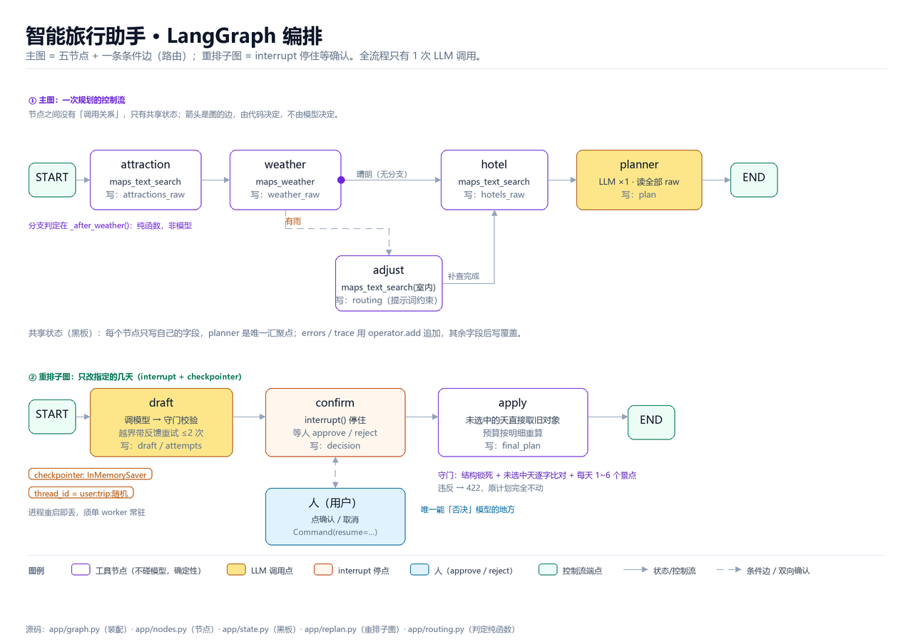

# 智能旅行助手（LangGraph + 高德 MCP）

一个能用的行程规划 Agent：输入城市、日期、偏好和预算，输出逐日行程、预算明细、
天气提示、装备清单，可以编辑、AI 局部重排、导出日历、生成只读分享链接。

**架构一句话**：LangGraph 五个节点 + 一条条件边（有雨才走室内补查），
全流程只有 **1 次 LLM 调用**；工具参数由代码写死，不交给模型猜。



## 快速开始

```bash
# 1. 装依赖（Python 3.11+）
python -m venv .venv
. .venv/Scripts/activate      # Windows；macOS/Linux: source .venv/bin/activate
pip install -r requirements.txt

# 2. 配 key
cp .env.example .env          # 然后填 LLM_API_KEY / AMAP_MAPS_API_KEY（必需）

# 3. 起服务
uvicorn app.api:app --reload --port 8000
# 打开 http://127.0.0.1:8000
```

跑测试：

```bash
pytest -q                     # 后端 323 项，全部离线可跑（不联网、不调模型）
```

## 部署到 Vercel

仓库里已经带了 `vercel.json` 和 `api/index.py`，推到 GitHub 后在 Vercel 里
Import 这个仓库即可，无需改构建命令。

**必须在 Vercel 项目设置里加环境变量**（Settings → Environment Variables）：
`LLM_API_KEY`、`LLM_BASE_URL`、`LLM_MODEL_ID`、`AMAP_MAPS_API_KEY`、
`AMAP_JS_KEY`、`AMAP_JS_SECURITY_CODE`。

三个必须知道的限制（不是 bug，是 Serverless 的本质）：

| 限制 | 原因 | 影响 |
|---|---|---|
| **数据不持久** | Vercel 文件系统除 `/tmp` 外只读；`api/index.py` 已把 `TRIP_DATA_DIR` 指到 `/tmp` | 冷启动后已保存的行程会丢失 |
| **单次请求有时长上限** | `vercel.json` 写了 `maxDuration: 300`，但 **Hobby（免费）计划最多 60 秒**，Pro 才能到 300 | 免费版上一次完整规划（本地实测 40~240 秒）大概率超时；想稳定跑要么升 Pro，要么把行程压到 2~3 天 |
| **AI 重排会话会丢** | 会话存在进程内存（`InMemorySaver`），Serverless 不保证同一实例 | 点"确认"时可能 404，需重新提交 |

要真正上线，得把文件存储换成数据库（SQLite/Postgres），并把重排会话换成外部存储（Redis）。
这部分**没有做**，README 里如实写着。

## 部署到常驻平台（Railway / Render，推荐）

Vercel 是 Serverless，单次请求有硬上限（免费计划 60 秒级），而一次规划需要 40~240 秒，
**会在返回前被掐断**（浏览器看到 `ERR_CONNECTION_CLOSED`）。换到常驻平台就没有这个问题，
而且内存会话、文件存储都能正常工作。

### Railway（最快）

1. https://railway.app → **New Project → Deploy from GitHub repo** → 选这个仓库
2. Railway 会读 `Procfile` 自动起服务
3. **Variables** 里加那 7 个环境变量（名字见 `.env.example`）
4. Settings → **Generate Domain**，得到 `https://xxx.up.railway.app`

### Render

1. https://render.com → **New → Blueprint** → 选这个仓库（会读 `render.yaml`）
2. 按提示填 `sync: false` 的那几个变量
3. 部署完成后访问给出的域名

两个平台都建议把 `TRIP_DATA_DIR` 指向持久卷；不配的话重启丢数据（和 Vercel 一样的限制）。

## 项目结构

```
app/           后端：LangGraph 图、节点、模型、存储、导出、分享
  graph.py     图装配（5 节点 + 条件边）
  nodes.py     各节点实现（只有 planner 调模型）
  state.py     共享状态（黑板）：errors/trace 用 operator.add 追加
  ics.py       导出 .ics（RFC 5545：转义、75 八位组折行、时区）
  packing.py   装备清单（规则引擎，每条带原因）
  share.py     只读分享链接（token 不可猜、可撤销）
tests/         323 项后端测试 + 4 个前端测试（jsdom，共 41 步）
web/           零构建前端（原生 JS，由 FastAPI 直接托管）
frontend/      Vue3 + Vite 版（源码，本机构建环境受限，未同步）
docs/          架构图（流程图 / 数据流 / 时序 / 状态 / LangGraph）与绘图脚本
```

## 安全说明

- 仓库里**不含任何密钥**；`.env` 被 `.gitignore` 排除，模板见 `.env.example`
- 用户身份走 `X-User-Id` 请求头做**隔离**，这不是认证——设计取舍见 README 正文
- 分享 token 用 `secrets.token_urlsafe(18)`（约 144 bit），只读、可撤销、响应里不含用户 id

---

## 以下是开发日志（原文保留）

> 这部分是开发过程的记录，含作者本机的绝对路径（如 `D:\PRACTICE\...`），
> 只作背景参考，不影响克隆后运行。

# 智能旅行助手（LangGraph 版）

教材第十三章的收官项目，按"接真实高德 MCP、不做前端、预算由 LLM 估"的要求实现。
用 LangGraph 而不是 hello_agents：一次纯框架的从零搭建，也能和自建框架做对照。

## 链路

```
TripRequest ──► attraction ──► weather ──┬──(有雨)──► adjust ──┐
                   │             │        └──(晴朗)────────────┴──► hotel ──► planner ──► TripPlan
                   │             │                                    │            │
              maps_text_     maps_weather                       maps_text_   唯一一次 LLM
               search                                              search     （排日程 + 估预算）
                   └────────── 同一个高德 MCP 会话（HTTP 端点 15 个工具）──────────┘
```

节点之间靠 State 传字符串原文（高德返回的 JSON 文本原样往下带），
只在最后一跳把它变成 `TripPlan`——契约校验放在出口，失败时能拿到模型原文。

**图**：`docs\智能旅行助手-LangGraph图.png`（主图五节点 + 条件边；重排子图含 interrupt；
每个节点标注了读写的状态字段）。

### 条件路由：下雨改室内

`weather` 之后是一个**条件边**，不是固定的一条线：

| 天气 | 走向 | 做什么 |
|---|---|---|
| 晴 / 多云 / 阴 | 直接 `hotel` | 什么都不多做 |
| 雨 / 雪 / 雷 / 沙尘 / 大风 | 先 `adjust` | 补查室内候选（博物馆 / 美术馆 / 科技馆），并把"当天必须室内"写进提示词 |

三个刻意的决定：

1. **判断是确定性的**（`app/routing.py` 纯函数），不交给模型——模型对"今天算不算坏天气"会
   各说各话，而这种判断本来就有明确规则。
2. **不自动改行程**。改行程要重新调模型，代价大且结果不可控；这里只把约束给足，
   生成后再做一次**确定性校验**：坏天气那天还排着"确定是室外"的景点（公园/山/湖/街/陵…），
   就记 `routing.violations` 并在界面提示"建议手动替换"。
3. **判断不出来就不猜**（`classify_poi` 返回 `unknown`）。误报比漏报更烦人——
   用户会开始无视所有提示。

响应里带 `routing: {needed, days, violations}`，前端显示一张「☔ 天气调整」卡片。

```

节点之间靠 State 传字符串原文（高德返回的 JSON 文本原样往下带），
只在最后一跳把它变成 `TripPlan`——契约校验放在出口，失败时能拿到模型原文。

## 环境要求

- Python 3.11+，`langgraph` / `langchain-openai` / `pydantic` / `mcp`
- 高德 Web 服务 Key（[控制台](https://console.amap.com/) → 应用管理 → 添加 Key → 服务平台选「Web 服务」）
- LLM 的 API Key

`.env` 放在 `D:\PRACTICE\.env`（工作区根），需要：

```
LLM_API_KEY=...
LLM_BASE_URL=https://aihubmix.com/v1
LLM_MODEL_ID=gemini-3-flash-preview
AMAP_MAPS_API_KEY=...
# UNSPLASH_ACCESS_KEY=...   可选：只影响景点配图，前端不做时可以不给
```

## 运行

### 方式一：命令行

```cmd
cd /d D:\PRACTICE\trip_planner
..\.venv2\Scripts\python.exe -m app.cli --city 北京 --days 3 --start 2026-11-01 --end 2026-11-03
```

常用参数：

| 参数 | 默认 | 说明 |
|---|---|---|
| `--transport` | `streamable-http` | 高德 MCP 传输方式，可选 `stdio`（走 `npx`） |
| `--fake-amap` | 关 | 用假高德数据跑通全图，不需要高德 Key |
| `--out` | 空 | 把 Markdown 结果写到文件 |
| `--preferences` | 历史文化 | 影响景点搜索关键词 |
| `--budget` | 中等 | 预算档位，交给 LLM 参考 |

### 方式二：Web（零构建版，开箱即用）

```cmd
cd /d D:\PRACTICE\trip_planner
..\.venv2\Scripts\python.exe -m app.api
```

打开 <http://127.0.0.1:8000/> —— FastAPI 直接托管 `web/` 里的 HTML/JS/CSS，
不需要 Node、不需要打包。导出用浏览器「打印 / 另存为 PDF」。

### 方式三：Web（Vue3 + Vite 版）

```cmd
cd /d D:\PRACTICE\trip_planner\frontend
npm install
npm run dev          →  http://localhost:5173
```

Vite 已配好 `/api` 代理到 `127.0.0.1:8000`，所以**后端要同时开着**（方式二那条命令）。

这个版本比零构建版多了「导出图片 / 导出 PDF」（html2canvas + jsPDF）。

> 为什么要两套：Vite 依赖 esbuild，而 esbuild 要 spawn 子进程；在受限环境里
> `spawn` 会被拒（`EPERM`），`vite build`/`vite dev` 都起不来。零构建版保证
> 任何环境都能演示。两套共用同一份 `style.css` 和同一个 `/api/trip/plan`。

### 地图

两类 Key 不要混（都在同一个高德应用下创建，只是服务平台不同）：

| 变量 | 平台类型 | 用途 |
|---|---|---|
| `AMAP_MAPS_API_KEY` | Web服务 | 后端调 REST：MCP 工具、**静态地图** |
| `AMAP_JS_KEY` + `AMAP_JS_SECURITY_CODE` | Web端(JS API) | 浏览器里画**交互地图** |

- `/api/config/map` 把 JS Key 与安全密钥下发给页面（安全密钥只用于本地开发，
  生产应该走高德的服务端代理方案）。
- `/api/staticmap` 由服务端用「Web服务」Key 取图再同源返回——**导出图片靠它**：
  交互地图是 canvas，`html2canvas` 抓不到，这是教材里也承认的坑；我们先插静态
  地图再截图，导出的图里就有地图。
- 没配 JS Key 时，页面自动降级为静态地图，不影响使用。

## 测试

```cmd
..\.venv2\Scripts\python.exe -m pytest -q
```

19 项，不需要高德 Key，也不需要真实模型：用 `FakeAmap` 供数据、用 `FakeLLM` 供规划 JSON。

覆盖的点：图能跑通、三个工具按序调用、参数来自请求、trace 记录、预算按分项重算、
单工具失败不中断、模型输出不可解析时保留原文、Markdown 围栏与前后闲话、温度字符串解析、
schema 违规被拒、`day_index` 重排、`isError` 翻成异常、预检把无效 key 变成快速报错。

## 几个刻意的设计选择

**1. 工具参数不让模型猜。** 教材四个 Agent 各自带提示词、由模型决定调哪个工具。
这里 keywords 就是用户偏好、city 就是目的地，是确定的——让模型再决定一次只会
多一次调用、多一个出错点。模型的能力留给真正需要判断的环节（排日程、估预算）。

**2. 预算以分项为准。** 模型给的 `total` 经常和四项之和对不上，出模型后统一重算
（`Budget.recompute_total()`），保证"明细"和"合计"永远一致。

**3. `day_index` 不交给模型。** 实测模型会从 1 开始编号甚至乱序，这个是展示用序号，
按列表顺序重排即可。

**4. `isError` 必须翻成异常。** MCP 把失败表达成 `isError=True` + 文本，不抛异常。
不转换的话，一句 `INVALID_USER_KEY` 会被当成正常数据喂给模型。

**5. 默认走 streamable-http。** 官方推荐，纯 HTTP，不依赖 Node，也不会碰上
"asyncio 子进程要命名管道"这类环境限制。stdio 保留为 `--transport stdio`。

## 已知限制

- **地图**：需要**两个不同平台类型**的 Key —— 「Web服务」（后端取静态地图）和「Web端(JS API)」+ 安全密钥（浏览器画交互地图）。没配 JS Key 时页面自动降级成静态地图。
- **图片未接入**：`UNSPLASH_ACCESS_KEY` 是可选配置，给了也只在数据里带上 `image_url`。
- **无多轮编辑**：教材的"行程编辑"在前端做，这里没有；如需在图里支持，应改用 `interrupt`。
- **条件路由只处理天气**：只有"下雨改室内"这一条分支。更细的（人多/闭馆/距离过远）没做。
- **改室内靠提示词 + 事后校验**：不保证模型一定照做；违规会被记录并提示，但不会自动重排。
  要真"保证"，得把景点选择整体从模型手里拿回来（结构化排程），那是另一个量级的改动。
- **顺序执行**：三个工具节点串行。MCP 会话是单连接，并行收益有限；换成并行需要多会话。
- **两种传输的工具数不同**：HTTP 端点 **15 个**，stdio 的 npx 包 **12 个**（少 `maps_schema_personal_map` / `maps_schema_navi` / `maps_schema_take_taxi`），且 `maps_direction_bicycling` 在 stdio 里叫 `maps_bicycling`。本项目只用 `maps_text_search` / `maps_weather`，两边同名，切换传输不用改代码。

## 一次真实的踩坑：key 无效会把客户端卡死

第一版直接调 `streamablehttp_client`。用假 key 试时，高德端点返回的是
`{"status":"0","info":"INVALID_USER_KEY"}`——**HTTP 200 + 非 MCP 报文**。
客户端等不到 JSON-RPC 回包，就一直在等，实测挂了 **10 分钟**没有返回。

修法是在开会话前先发一个裸 HTTP 请求做预检（`AmapMCP._preflight`）：
看到 `INVALID_USER_KEY` 或 `infocode=10001` 就直接抛 `AmapKeyError`。
改完之后同样的假 key 在 **0.9 秒**内报错，并给出"去哪检查"的提示。

判定逻辑抽成了纯函数 `_classify_preflight`，由 4 条测试钉住——
这一段决定"卡住"还是"报错"，不该靠人工试。
## 真机跑过两次

详见 [docs/真实运行记录.md](docs/真实运行记录.md)。摘要：

| 运行 | 耗时 | 结果 |
|---|---|---|
| 北京 3 天 | 43.4s | 3 天行程，预算 1265 元，工具返回 3464/885/3601 字符 |
| 北京 2 天 · 自然风光 | 26.8s | 颐和园→万寿山→圆明园 全在西北片区；景山→北海 市中心；预算 712 元 |

两次都发现并修掉了真问题：模型用「无」表示当天不住宿、以及同一天景点横跨城区。
## 景点配图（Unsplash）

只需要 **Access Key**：

```
UNSPLASH_ACCESS_KEY=...
```

**Secret Key 不要填也不用填** —— 它只在 OAuth 授权流程（替用户登录）里用，
本项目是服务端公开搜索，用 `Client-ID` 就够了。把 Secret 写进配置是多余的风险。

实现要点：

- 按「城市 + 景点名」做磁盘缓存（`.cache/unsplash.json`）：Demo 配额只有 50 次/小时，
  不缓存跑几次就到顶。
- 缓存命中的景点**根本不进查询层**，连函数调用都省了。
- 同一景点在多天出现：只查一次，但**每个实例都回填**（第一版只填了第一天，测试抓到的）。
- 403 限流 / 网络失败都不抛错，只是 `image_url` 留空，行程照常返回。
## 排查过的真问题（都是跑出来的，不是想出来的）

| 现象 | 根因 | 修法 |
|---|---|---|
| 第 1 个景点在地图上不显示 | 三个景点相距约 100 米，`setFitView` 停在 zoom 11（100 米≈1.7 像素），被第 2 个盖住 | 标记加 `zIndex`（序号小的在上）、`setFitView` 给 60px 边距并把 maxZoom 提到 16 |
| 偶发 502「hotel.name 必填」 | 模型用 `"hotel": {}` 表示当天不住宿 | `_none_if_empty()` 把空壳归一成 None（location 同理） |
| 天气偶发 30 字符、酒店 67 字符 | 高德 MCP 连续调用偶发返回空壳（不是 isError） | 载荷校验 + 重试一次；挡不住就记错误、行程继续 |
| 天气拿到了但 `weather_info` 为空 | 模型没把 forecasts 抄进输出 | **由程序从工具原文重建** weather_info，不经模型 |
| 明明查南京却返回北京景点 | 测试端（PowerShell）把中文按 Latin-1 发出去，服务端收到乱码 | 服务端无问题；用 UTF-8 客户端（浏览器/Python）正常 |
| 500 + `APIConnectionError` | 代理偶发 `RemoteProtocolError: Server disconnected` | planner 捕获模型异常并重试一次，仍失败返回 503（可重试）而非 500 |

**教训**：上面 6 条里，有 1 条是我的测试工具错了（PowerShell 编码），差点被当成服务端 bug 去改。**测服务端之前，先确认客户端发出的字节是对的。**
## 前端：视觉与布局（2026-10-29 重做）

原来那版 CSS 是十几轮补丁堆出来的（1232 行，颜色和间距散落在组件里）。这次整体重写，
同一份 DOM、同样的类名，只换外面这层皮。

### 骨架

```
[appbar]  品牌 + 一句话说明（sticky，玻璃质感）
[layout]  ≥1080px 两栏：主栏（表单 / 工具条 / 结果） + 侧栏（记忆 / 已保存行程，sticky）
          <1080px 单栏；<640px 表单变一列、预算改两列
[footer]  数据来源
```

侧栏只在桌面出现，`sticky` 并自带滚动——**保存过的行程列表长起来不会把整页顶长**。

### 背景：一张纸上的地图

不是随便加个渐变。这是旅行产品，背景该暗示的**是地图**：

| 图层 | 做法 | 担心什么 |
|---|---|---|
| ① 底 | 顶部带一点靛蓝的纸白，向下过渡到纯纸白 | 纯平色会让整页像表格 |
| ② 经纬网 | 56px 细网格 + **径向遮罩**只留在上半屏 | 满屏网格像工程图；裁掉下半才像"纸上的地图" |
| ③ 天光 | 三团极淡径向渐变（靛蓝 / 天蓝 / 暖黄）+ 一点青绿，42 秒极慢漂移 | 静止页面太死；但动效不能抢注意力 |

几条硬约束（都写进代码注释了）：

- **不用外部图片**：演示环境可能断网，背景不能成为失败点。
- **不用 `filter: blur`**：大面积模糊是低端机掉帧主力，柔光一律用径向渐变做。
- **动画只动 `transform`**：走合成层，不触发重排（有测试盯着这条）。
- **别挡路**：`z-index: 0`、`pointer-events: none`、`aria-hidden="true"`。
- **高对比度偏好**（`prefers-contrast: more`）下网格与天光直接不显示——
  对需要高对比的人，装饰线是干扰，不是美化。
- 深色模式只换 token；打印直接隐藏。

顺带把顶栏和工具条改成半透明 + 背景模糊（玻璃感），让它们"浮"在底纹上。
写法规矩是**先给不透明兜底，再覆盖成玻璃**——不支持 `color-mix` 的浏览器不会变成透明渣。

### 动效：四种，都有理由

静态底纹看着"素"，所以加了动，但每一种都要能说出为什么：

| 动效 | 时长 | 为什么 |
|---|---|---|
| 航线虚线流动（`route-flow`） | 9 / 11 / 13s | 让"地图"这一层有方向感；只改 `stroke-dashoffset` |
| 一架飞机沿主航线巡航（SVG `animateMotion`） | 30s 一轮 | 这是旅行产品，飞机比任何装饰都贴题；SVG 原生动画，不占主线程 |
| 城市点呼吸（`dot-breathe`） | 5.5~8s 错峰 | 让点像"有生命"，不是印刷网点 |
| 网格缓慢明暗（`grid-breathe`） | 18s | 极慢的呼吸，防止画面显得死板 |

另外两个"一次性"的：结果卡片入场（`rise`，0.32s，**只在查看态播**——编辑时每次增删都会重渲染，
跟着播会闪）、进度条流光（`bar-shine`，只在加载时出现）。

三条规矩：

1. **所有 `@keyframes` 只碰 `transform` / `opacity` / `stroke-dashoffset`** ——
   有测试逐块扫描，出现 `top/width/margin` 之类就报错（那会每帧重排）。
2. **能用 SVG 原生就用原生**：飞机走 `animateMotion`，不写一行 JS。
3. **`prefers-reduced-motion` 下全部停掉**（`animation: none`，不是把时长缩到 0.001ms）。

### 一个真实教训：`[hidden]` 会被 `display` 盖掉

用户截图上出现了一条"多余的白杠"——那是**空工具条**：`#toolbar` 明明带了 `hidden` 属性，
但我在样式里写了 `.toolbar { display: flex }`。浏览器默认样式只有 `[hidden] { display: none }`，
作者样式里任何 `display` 都会盖掉它，于是空工具条照常占位。

修法不是在工具条上打补丁，而是加一条全局规则：

```css
[hidden] { display: none !important; }
```

一次管住所有"靠 hidden 隐藏"的元素（工具条 / 记忆卡 / 重排面板 / 进度条 / 灯箱），
并加了断言：规则在、且 `.toolbar` 确实是 `display: flex`（证明这条规则不是摆设）。

### 设计系统

全部走 CSS 变量，组件里不写死颜色和尺寸：

| 类别 | 变量 | 说明 |
|---|---|---|
| 表面 | `--bg` `--surface` `--surface-2/3` | 纸白底 + 三级表面，层级靠表面差而不是边框 |
| 文字 | `--ink` `--ink-2` `--muted` `--muted-2` | 正文 / 次要 / 说明 / 极弱 |
| 品牌 | `--brand` `--brand-2` `--brand-soft` `--brand-ink` | 靛蓝，软色用于 chip 与选中态 |
| 语义 | `--ok` `--warn` `--danger`（各带 `-soft`） | 餐 / 提示 / 错误 |
| 间距 | `--s-1..--s-8`（4→44px） | 组件只许用这几档 |
| 字号 | `--fs-xs..--fs-2xl`（12→26px） | 中文优先落到苹方 / 微软雅黑 |
| 圆角 / 阴影 | `--r-*` / `--sh-1..3` | 三级阴影够用，不叠加 |

几条刻意的选择：

1. **数字用 `tabular-nums`**。预算五个格子上下对不齐，整块看起来就是业余的。
2. **深色模式只覆盖 token**（`prefers-color-scheme: dark`），不改任何组件规则——
   否则两份主题会分叉，改一个地方得改两遍。
3. **行内色值全部清掉**。餐 / 宿标签原来写死 `#e8f8f1`，深色模式下刺眼；现在走 `--ok-soft` / `--warn-soft`。
4. **焦点环只在键盘操作时出现**（`:focus-visible`），鼠标点击不闪蓝框。
5. **动效 140~220ms**，`prefers-reduced-motion` 下全部关掉。
6. **打印是功能不是附赠**：`@media print` 里隐藏 appbar / 表单 / 工具条 / 侧栏 / 灯箱，
   保留每天那张静态地图，并 `break-inside: avoid` 防止一天被切两页。

### 怎么看它有没有坏

浏览器打不开（沙箱里 Edge 的 headless 起不来，mojo 需要命名管道），所以**没有截图可看**。
替代方案是三组能自动跑的检查：

| 检查 | 看什么 |
|---|---|
| `tests/web_style.test.cjs`（27 项） | 整份 CSS 能被解析、token 无悬空引用、大括号成对、关键选择器在、深色模式只改 token、打印规则在、label 带 `for` |
| `tests/web_dom.test.cjs`（32 步） | 结构没被改坏：所有交互仍然可用 |
| `tests/web_realdata.test.cjs`（8 项） | 用**真实接口返回**的计划渲染：天数、行数、预算合计、天气条数、无异常日志 |

第三组是这次专门加的：单元测试里的数据是我编的（景点名三四个字、一天两三个），
真实数据会出现 15 字的长名字、一天五六个景点——那才是排版的压力点。

## 前端：编辑行程与页面结构

生成结果后顶部会出现一条**常驻工具条**（`position: sticky`），不用滚回顶部找按钮：

```
[✏️ 编辑行程] [打印/存为 PDF] [复制 Markdown]            [重新规划]
```

进入编辑态后，工具条变成 `[完成编辑] [撤销改动]`，页面上所有可改的地方都变成输入框。

### 能改什么

| 位置 | 字段 |
|---|---|
| 概览 | 城市、总体建议 |
| 每天 | 当天概述、交通方式（下拉） |
| 酒店 | 名称、每晚价格（留空即"当天不住宿"） |
| 景点 | 名称、游览分钟、门票，↑↓ 调顺序，✕ 删除 |
| 餐饮 | 名称、人均，✕ 删除 |
| 每天底部 | `+ 添加景点` / `+ 添加餐饮` |

### 三个实现要点

1. **编辑不重渲染整页**。手写编辑功能最常见的坑是"每敲一个字重建 DOM → 输入框失焦"。
   这里用事件委托 + 只更新 budget 区域的数字，输入焦点能保住（有测试盯着：
   `⑦ 改门票后输入框仍保留输入值与焦点`）。
2. **预算按明细重算**。模型给的各项可能和明细对不上，编辑后更对不上。所以
   门票 = Σ 门票、餐饮 = Σ 人均、住宿 = Σ 有真实名字的酒店，交通沿用模型估算
   （自驾是油费+停车，无法从明细推导），合计永远是这四项之和。
3. **逻辑与渲染分离**。`web/logic.js` 是纯函数（预算、排序、校验），
   浏览器和 Node 都能加载；Vue 版也 `import` 同一份文件，避免两套算法分叉。

### 测试

```cmd
check_frontend.cmd
```

- `tests/web_logic.test.cjs` —— **35 项**纯逻辑用例（预算、排序、冲突检测、拖拽移动、校验）
- `tests/web_dom.test.cjs` —— 用 **jsdom** 把 `index.html + logic.js + app.js` 真跑一遍，
  按真实操作顺序走 **29 步**：城市检索 → 折叠分组 → 记忆删除 → 生成 → 改价 → 冲突提示 →
  拖拽 → 删除 → 新增 → 撤销 → 完成编辑 → 保存 → 重新规划

不需要浏览器、不需要联网，也不会碰真实接口（fetch 被换成固定数据）。

## 前端：这一轮新加的交互

| 功能 | 入口 | 实现要点 |
|---|---|---|
| **行程冲突检测** | 编辑时每天卡片下方自动出现 | 单日 >10 小时 / 相邻景点 >40 km / 同日重复。用**直线距离**粗筛，不用真实路径（编辑时每敲一下都请求不现实） |
| **拖拽排序** | 编辑态每行左侧 `⋮⋮` | 支持跨天；状态存模块变量而非 `dataTransfer`（jsdom 没有它，否则拖拽无法自动测试）；**↑↓ 按钮保留**给键盘和手机 |
| **图片灯箱** | 点任意缩略图 / 每日地图 | ✕、点遮罩、`Esc` 三种关闭；复用页面里的静态容器（曾因新建容器导致两个 `id=lightbox`，"点了没反应"） |
| **大图** | 同灯箱 | 后端存 `image_url`(w=400) + `image_url_large`(w=1600)；旧缓存靠 `upgrade_url()` 改 `w=` 参数推出大图，**不重打 Unsplash、不耗配额** |
| **城市检索** | 点或输入「目的地城市」 | 后端自带 344 个城市；支持中文 / 全拼 / 首字母（`nj`→南京）；防抖 120ms + **丢弃过期响应**；短查询只做前缀匹配（否则 `nj` 会命中"天津"） |
| **按省份折叠** | 空输入时 | 29 个分组（原生 `<details>`）；直辖市默认展开；输入关键词自动切回平铺；`↑↓` 只在展开的组里移动 |
| **右键取消城市** | 右键候选项 | 写入 `localStorage['trip.hiddenCities']`，只影响本机；列表底部出现"已隐藏 N 个 · 点此恢复" |
| **记忆可纠正** | 侧栏「🧠 它记住了什么」 | 画像逐项显示，点 × 调 `DELETE /api/profile/hints`；删完下次规划不再参考 |

城市检索的一个取舍写在代码里：**344 个城市只给高频 114 个标拼音**，其余按中文匹配——
手写 344 个拼音错一个字母就搜不到，宁可少一种匹配方式，也不要给错数据。

## 多轮编辑：只重排指定的几天（LangGraph interrupt）

工具条「🤖 AI 重排」→ 面板勾选若干天 + 写一句要求 → 模型重排 → **停下来等确认** → 确认才落库。

```
POST /api/trips/{id}/replan           {selected_days:[1,2], requirement:"..."}
  → {status:"pending", preview:{days:[{day_index,date,before,after,...}]}}   ← 图停在这里
POST /api/trips/{id}/replan/confirm   {approve:true|false}
  → {status:"applied", plan, markdown}  或  {status:"rejected"}
```

图结构：

```
START → draft（调模型 + 守门 + 合成）→ confirm（interrupt 等确认）→ apply → END
                  └─ 校验不过 → END（返回 422 和原因）
```

### 为什么把 interrupt 放在"生成之后、落库之前"

放在生成之前只是多一次点击，没有信息量；放在这里，用户看到的是**具体 diff**（第 2 天
"玄武湖公园" → "南京博物院"），确认才有意义；落库前停住，**拒绝时原计划天然不受影响**。

### 局部性怎么保证（`app/local_edit.py` 纯函数）

| 规则 | 说明 |
|---|---|
| 结构锁死 | 天数、日期序列、城市不许变 |
| 补集不变 | 未选中的天，day 数据必须逐字相同（用 `sort_keys` 稳定序列化比对） |
| 选中天有效 | 每天 1~6 个景点 |
| 越界重试 | 违反就把"哪几天被越界"反馈给模型重试一次，仍失败返回 422 且**原计划不动** |
| 构造上保证 | 合成时未选中的天**直接取旧对象**，不是"相信模型没改" |

预算不在"逐字不变"范围内：门票换了就会变，所以由程序按明细重算（与前端口径一致），
交通沿用原值（油费无法从明细推导）。

### 限制

- 会话状态在 `InMemorySaver` 里：**进程重启即丢**，所以后端要单 worker 常驻。
- 同一行程同时只允许一个未完成会话，第二次请求返回 **409**——两个会话改一份计划，
  最后写入的会覆盖前面，没法解释。
- 「AI 重排」按钮需要先保存过一次（要有 trip_id）。

测试：`tests/test_local_edit.py` 22 项（结构 / 补集 / 数量 / 合并 / 预算 / diff）、
`tests/test_replan.py` 12 项（真中断、续跑、越界重试、拒绝不改）、
`tests/test_replan_api.py` 9 项（pending→apply、409、404、400、422）。

## 预算与其他要求

比"预算档位"更具体的一层输入：**总预算（元）** 和 **其他要求（一句话）**。

| 输入 | 进到哪 | 谁保证 |
|---|---|---|
| `budget_total` | 提示词"预算上限"段 + 响应里的 `budget_check` | 提示词只是"请求"，`check_budget()` **重新算一遍**：超了就报超出多少、哪一项最大 |
| `notes` | 提示词"其他要求"段 + **酒店搜索词** | 提示词约束模型；`derive_hotel_keyword()` 把"想住舒适一点"映射成搜索词 |

两个坑，都是实测出来的：

1. **光把要求写进提示词没用。** 用户说"想住舒适一点的酒店"，但表单住宿类型是"经济型酒店"，
   高德搜索词也就跟着是"经济型"——模型只能在这几家便宜旅馆里挑，提示词再狠也变不出舒适型。
   所以加了确定性映射（`app/prefs.py`）：识别"舒适/高端/省钱/民宿"等意图去改**搜什么**，
   识别不出来就沿用表单值，不猜。实测：说了"舒适"搜到 600 元/晚的酒店，不说搜到 220 元。
2. **模型会"假称已满足"。** 预算 600 元却要求住舒适，它会选 200 元的旅社，然后在建议里写
   "为满足住宿舒适度要求"。加了第 4 条硬规则：做不到就必须明说"受预算限制，要舒适需追加约 N 元"。

`_traced` 包装器原来是 `update = {**update, "trace": [note]}`，会把节点自己写的 trace **覆盖**掉；
改成追加，否则"搜索词被调整"这类信息在排查时看不到。

## 导出、装备清单与分享

三个"不需要模型"的功能，正好各补一个方向：

| 功能 | 接口 | 关键决定 |
|---|---|---|
| **导出 .ics** | `GET /api/trips/{id}/export.ics` | 按 RFC 5545：逗号/分号/反斜杠转义、**75 八位组折行**（中文按字节算）、`TZID=Asia/Shanghai` + `VTIMEZONE`。**用餐与景点共用一个游标排时间**，所以结构上不重叠（早餐 08:00、午餐排到哪算哪但不早于 11:30、晚餐 ≥18:00、入住 ≥20:00） |
| **装备清单** | `GET /api/trips/{id}/packing`（规划响应里也带 `packing`） | **规则引擎**，不是模型写的：下雨→伞、温差≥8→外套、≥3 天→换洗。每条带 `reason`，指向输入里的具体事实（"2026-11-05 有雨/雪"） |
| **只读分享** | `POST/DELETE /api/trips/{id}/share`、`GET /api/share/{token}` | `secrets.token_urlsafe(18)`（24 字符，约 144 bit）；只读、可撤销、**响应里不含用户 id**；行程删了链接自动失效 |

几处踩过的细节：

- **中文文件名不能直接进 header**：HTTP 头按 latin-1 编码，`filename="南京.ics"` 会 500。
  改成 ASCII 兜底 + RFC 5987 的 `filename*=UTF-8''...`。
- **只读模式要"不渲染"而不是"CSS 藏起来"**：藏起来但 DOM 里还在，读屏和键盘照样能碰到。
- **拿 token 当身份去写**：服务端会把它当成一个新用户，在 `data/trips/<token>/` 下另存一份——
  改不到原主的数据，但说明"任意字符串都能当用户名"。测试里如实断言"原主数据没变"，
  不假装请求会失败。

测试：`test_ics.py` 21 项、`test_packing.py` 19 项、`test_share.py` 18 项、
`test_features_api.py` 15 项；前端新增 4 步 DOM（装备清单 / 导出 / 分享 / 只读模式）。

## 持久化与撤销

### 存在哪

行程存成 JSON 文件：`data/trips/<id>.json`（`app/store.py`）。

- 不用数据库：量级是"几十份行程、单机自用"，一份 JSON 能直接 `git diff` 看改动。
- 写入用 `tmp.replace()` **原子替换**，写一半断电不会留半份坏文件。
- `id` 只允许 `[A-Za-z0-9_-]`，落盘前再校验一次，防 `../../.env` 路径穿越
  （有测试：`GET /api/trips/..%2F..%2F.env` → 404）。
- 列表按文件 mtime（纳秒）排序。**按 `updated_at`（秒级）排会撞车**——同一秒存两份
  时顺序就变成随机的，这个 bug 是测试抓到的。

### 接口

| 方法 | 路径 | 说明 |
|---|---|---|
| POST | `/api/trips` | 新建（服务端按 `TripPlan` 校验，不合法直接 422） |
| PUT | `/api/trips/{id}` | 覆盖保存同一份 |
| GET | `/api/trips` | 列表（只有元信息，不含全文） |
| GET | `/api/trips/{id}` | 取全文 |
| DELETE | `/api/trips/{id}` | 删除 |

### 前端行为

- 生成完**立刻自动存一份**，所以刷新页面也能从「已保存的行程」找回来。
- 之后每次改动 **1.2 秒防抖自动保存**，走 `PUT` 更新同一份，不会越存越多。
- 页面顶部列出已保存的行程，点开即载入，✕ 删除。
- 工具条显示 `保存中… / ✓ 已保存 / ⚠ 保存失败`。

### 撤销 / 重做

- 工具条常驻 `↶ 撤销` / `↷ 重做`，栈空时按钮自动禁用。
- 快捷键：`Ctrl+Z` 撤销、`Ctrl+Shift+Z` / `Ctrl+Y` 重做、`Ctrl+S 立即保存`。
- **非编辑态也能删景点**（方便），但一定可撤销——这是用户反馈后补的：
  原来非编辑态删掉就找不回来了。
- 撤销粒度是"一次焦点进出"，不是每个按键一步；否则按二十次 `Ctrl+Z` 才退掉一个字。
- 撤销后停在编辑态，方便接着改；`放弃全部改动` 会同时清空撤销栈
  （否则历史里混着已放弃的改动，再撤销就回到一个"已经不存在"的分支）。
## 打印 / 导出的地图

**踩过的坑**：一开始只有一张交互地图（day 切换），`window.print()` 只会印出当前选中的
那天，用户实测"转 PDF 只有第一天的地图"。

改成两层：

| 位置 | 内容 | 屏幕 | 打印 |
|---|---|---|---|
| 地图卡片 | 高德 JS API 交互地图（可缩放、按天切换） | 显示 | **隐藏**（`.no-print`） |
| 每天卡片底部 | 服务端渲染的静态地图（`/api/staticmap`） | 显示 | **显示** |

静态地图由后端用「Web服务」Key 取图后同源返回，所以能进 `html2canvas`，也不会有
跨域污染 canvas 的问题。Vue 版导出时还会临时隐藏交互地图、并等每张图片 `decode`
完成，否则截图里地图位置是空白。

`/api/staticmap` 带**内存缓存**（同一组点位 + zoom 命中直接返回，响应头 `X-Cache: MISS/HIT`）：
打印前会对每天各取一次图，不缓存的话一天打好几次 PDF 就能把高德静态地图的配额烧掉。
### 又一个自己挖的坑：`points` 里带 `name`

`/api/staticmap` 原来声明 `points: list[dict[str, float]]`，而前端 `dayPoints()`
返回的对象带 `name`（景点名，字符串）。Pydantic 试图把 `name` 转成 float：

```
422 float_parsing: ["body","points",0,"name"]
Input should be a valid number, unable to parse string as a number
```

结果**每张每日地图都变成"地图暂时取不到"**，打印出来的 PDF 里全是这行提示
（用户把 PDF 发过来才定位到）。

修法两处，缺一不可：

1. 后端改成真正的点位模型，并 `extra="ignore"` —— 公共接口应当容忍多余字段；
2. 前端只传 `{lng, lat}`，请求体也更小。

教训：`dict[str, float]` 这种"看起来够用"的签名，一旦前端多传一个字段就整段失效，
而且**报错信息藏在 422 的 detail 里，页面只显示一句兜底文案**。所以前端现在会把
状态码一起写出来（`地图暂时取不到（422）`），下次一眼能看出是请求错了还是网络问题。

另外顺手修了餐次标签被挤成竖排的问题（`.rank` 固定 22px 宽，"早餐"两个字会换行）。
## 多用户隔离与偏好记忆

一个人用不需要隔离，也没有"记住他"的价值——所以这两件事是一起做的。

### 隔离怎么做

- 前端每个浏览器一个稳定 id（`localStorage['trip.user']`，形如 `u-a1b2c3d4`），
  所有 `/api` 请求带 `X-User-Id` 头；
- 后端按用户分区落盘：`data/trips/<user>/<trip_id>.json`；
- `user_id` 只允许 `[A-Za-z0-9_-]{3,40}`，非法直接 400（防 `../` 路径穿越）；
- 拿别人的 trip id 取，返回 **404 而不是 403** —— 不告诉对方"这个 id 存在"。

**这不是认证**：没有密码、没有 token，改了 `localStorage` 就能换身份。
定位是"能隔离"，不是"能开放注册"。真要开放，得先做认证再做配额。

### 记忆怎么记

不做向量库：偏好/档位/交通/城市是**计数**，不是检索。

- 每成功规划一次，就把本次的 `preferences`/`budget_level`/`transportation`/`accommodation`/`city` 计数 +1；
- 下次规划时取出现最多的 2 项，拼成一段"该用户的历史偏好"**附加**在系统提示词末尾；
- 响应里带 `memory: {user, used, hints}`，前端在概览显示「已参考：历史文化 · 中等」。
- 失败的需求不记（`record` 只在 plan 生成成功之后调用）。

### 记忆是能改的

上面的画像只进不出就是黑箱：用户看不到记了什么、也删不掉。所以补了三个口子：

```http
GET    /api/profile                       # 看：{user, trips, hints, updated_at}
DELETE /api/profile/hints?field=&value=   # 删一项（前端 chip 上的 ×）
DELETE /api/profile                       # 整份清空（"重新开始"）
```

前端在侧栏「🧠 它记住了什么」逐项展示，点 × 就删，删完下次规划不再带它。
删除时只清指定项，其它字段保留——测试里专门盯着这一点
（`test_delete_hint` 断言删掉 `preferences` 后 `city` 还在）。

### 已知不足

- 记的是"常选什么"，记不住"住过哪家酒店"这类事实；
- 没有遗忘机制（一年前的偏好和昨天的一样重）；
- 画像不参与"排除"（不会因为去过就不推荐）。

测试：`tests/test_users_memory.py` 24 项（隔离 13 + 记忆 7 + API 4）+
`tests/test_profile_forget.py` 9 项（删除单项、缺失项 404、清空、不影响他人、非法用户 400）。